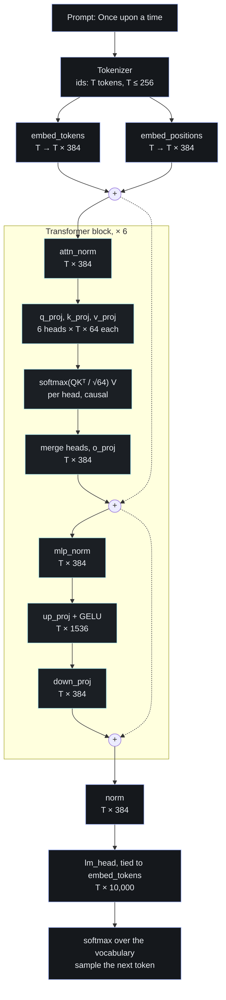
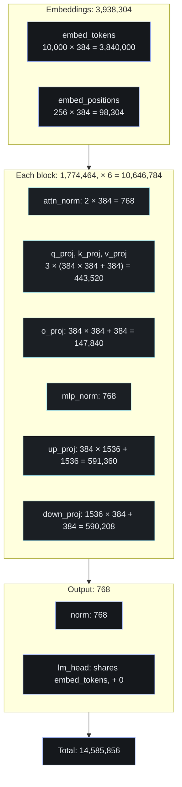

# Architecture

mvGPT is a decoder-only transformer, the family GPT-2 belongs to, scaled down to 14.6 million
parameters. It follows the decoder of [Attention Is All You Need](https://arxiv.org/abs/1706.03762)
(Vaswani et al., 2017), with the changes GPT-2 made to it: learned positions, LayerNorm before each
sublayer, GELU, and an output head that shares the token embeddings. All of it is in
[`model.py`](https://github.com/nenuadrian/mvGPT/blob/main/model.py).

## How data flows through it

A prompt becomes token ids, each id and each position becomes a vector of 384 numbers, and the sum
goes through six transformer blocks. A last LayerNorm and the output head turn each position's vector
into a score for each of the 10,000 tokens in the vocabulary, and a softmax turns the scores at the
last position into the probabilities the next token is sampled from.



1. **Tokens.** The tokenizer turns the prompt into a sequence of `T` ids, at most 256 of them.
2. **Embeddings.** `embed_tokens` looks each id up in a table of 10,000 rows, and `embed_positions`
   looks each position up in a table of 256 rows. Both give 384 numbers per token, and they're added
   together: that sum is the only way the model knows where a token is.
3. **Six blocks.** Each block reads a `T × 384` tensor and writes one of the same shape, so they can
   be stacked. The blocks are built alike, but each has its own weights and learns its own job.
4. **The output.** A last LayerNorm, then `lm_head` scores all 10,000 tokens at each position. In
   training, every position predicts the token after it; in generation, the last position's scores
   are what we sample from.

## Where the parameters are



About 73% of the parameters are in the six blocks, and two thirds of each block is its MLP. The
token embedding table is the other big piece, and it's counted once, as the output head uses the
same matrix.

## The pieces

### Config

```python
@dataclass
class GPTConfig:
    vocab_size: int = 10_000
    block_size: int = 256  # the context window, in tokens
    n_layer: int = 6
    n_head: int = 6
    n_embd: int = 384  # split between the heads: 6 x 64
    dropout: float = 0.1
    bias: bool = True
```

### Causal self-attention

Attention is where tokens exchange information. Each token's vector is projected three ways: a query,
a key and a value. Each head compares the queries with the keys to decide how much each token takes
from each other token's value:

$$
\text{Attention}(Q, K, V) = \text{softmax}\left(\frac{QK^\top}{\sqrt{d_k}}\right)V, \qquad d_k = 64
$$

The 384 channels are split into 6 heads of 64, which attend independently and are merged back with
`o_proj`. The attention is causal: a token sees itself and the tokens before it, never the ones after,
which is what lets the model generate from left to right. PyTorch's
`F.scaled_dot_product_attention` computes it, with `is_causal=True` for the mask, or a mask of its
own when a [KV cache](kv-cache.md) holds the keys and values of earlier tokens.

### MLP and GELU

The MLP works on each token on its own: it projects 384 channels up to 1,536, applies GELU, and
projects back down. GELU is a smooth version of ReLU: large positive inputs pass almost unchanged,
large negative ones go to about zero, and small negative ones keep a little of their value.

$$
\text{GELU}(x) = x \cdot \Phi(x) = \frac{x}{2}\left(1 + \text{erf}\left(\frac{x}{\sqrt{2}}\right)\right)
$$

### The block

```python
x = x + self.attn(self.attn_norm(x))
x = x + self.mlp(self.mlp_norm(x))
```

Each sublayer reads a normalised copy of `x` and adds its output back onto `x`. That residual path
lets each block make a small correction to the running representation, and LayerNorm keeps the
values each sublayer reads in a steady range.

### Weight tying and initialisation

`lm_head` shares its weight matrix with `embed_tokens`, which saves 3.84 million parameters. Weights
start from a normal distribution with a standard deviation of 0.02, and biases at zero. The two
projections that add into the residual stream, `o_proj` and `down_proj`, start smaller, by
`1 / sqrt(2 × 6)`, as each block adds to the stream twice.

### Generation

`generate` runs the model on the tokens so far, divides the last position's scores by a temperature,
optionally keeps the top k of them, samples a token from their softmax and appends it. It stops after
`max_new_tokens`, or when it samples the end-of-text token. It runs the prompt through the model
once, and then each new token on its own, with a [KV cache](kv-cache.md) of the keys and values of
the tokens before it.
