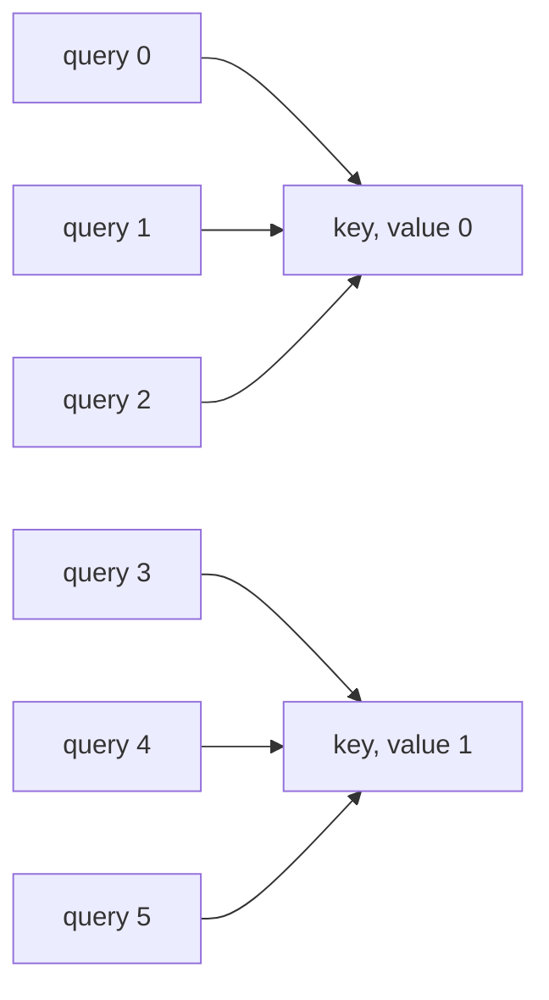

# Grouped-query attention

The [KV cache](kv-cache.md) keeps, for each token written so far, a key and a value in each head of
each block. For mvGPT, that's 2 × 6 blocks × 6 heads × 64 channels × 4 bytes = 18,432 bytes per
token, or 4.7 MB per story for a full window of 256 tokens. With grouped-query attention (GQA), the
query heads share their keys and values in groups: each group of query heads has one key head and one
value head, so the cache keeps fewer heads, and the key and value projections get smaller.

## Multi-head, grouped-query and multi-query attention

Multi-query attention ([Shazeer, 2019](https://arxiv.org/abs/1911.02150)) keeps a query per head, and
the heads share a single key head and value head. The paper's point is that training runs all the
positions of a sequence at once, while writing runs a token at a time, and each step loads all the
cached keys and values from memory, which takes longer than the arithmetic. In its translation model,
the decoder's time per token went from 46 to 3.8 microseconds on a TPU, for a quality slightly below
multi-head attention's, and better than models with fewer heads or smaller ones.

Grouped-query attention ([Ainslie et al., 2023](https://arxiv.org/abs/2305.13245)) sits in between:
$H$ query heads in $G$ groups, and each group shares a key head and a value head. $G = H$ is
multi-head attention, and $G = 1$ is multi-query attention. The paper also converts models trained
with multi-head attention, by averaging the key and value heads of each group and pretraining for
another 5% of the original steps: its largest T5 with 8 groups scored close to the multi-head model,
at close to the multi-query model's speed.

Head $h$ attends with its own queries, and the keys and values of its group's head $j$:

$$
\text{head}_h = \text{softmax}\left(\frac{Q_h K_j^\top}{\sqrt{d_k}}\right) V_j,
\qquad j = \left\lfloor \frac{h}{H / G} \right\rfloor
$$

As each head keeps its own queries, it scores the shared keys in its own way, and takes its own mix
of the shared values. With mvGPT's 6 heads and 2 key and value heads, groups of 3:



[Llama 2](https://arxiv.org/abs/2307.09288) uses GQA in its 34B and 70B models. Its appendix compares
the three at 30B parameters, with the feed-forward layers widened to keep the parameter count: GQA
scored about as well as multi-head attention on most tasks, and better than multi-query on average.
With a context of 256 tokens, the multi-head model ran out of memory at a batch of 1,024, where the
other two didn't. [Llama 3.1](https://arxiv.org/abs/2407.21783) uses 8 key and value heads at all
three of its sizes, and the dense models of [Qwen3](https://arxiv.org/abs/2505.09388), from 0.6B to
32B parameters, have 8 key and value heads for 16 to 64 query heads.

## In the code

`GPTConfig(n_kv_head=2)` gives each block two key and value heads. `None`, the default, means one per
query head, the multi-head attention mvGPT had, so checkpoints saved before load as they did, along
with the 12-head models of [distributed training](distributed.md). `n_head` has to be a multiple of
`n_kv_head`: with 6 heads, that's 6, 3, 2 or 1, and any other number raises a `ValueError`.

In [`model.py`](https://github.com/nenuadrian/mvGPT/blob/main/model.py), `k_proj` and `v_proj` project
to `n_kv_head × 64` channels, and the keys and values are viewed as `n_kv_head` heads. QK-norm and
rotary embeddings, when the config has them, apply as before, and the `KVCache` stores those heads,
which is the saving. Right before attention, `repeat_interleave` repeats each key and value head
`n_head // n_kv_head` times along the heads' dimension, so query heads 0, 1 and 2 line up with key and
value head 0, and 3, 4 and 5 with head 1:

```python
if cache is not None:
    k, v = cache.update(self.layer, k, v)
if self.n_kv_head != self.n_head:
    # The cache keeps the fewer heads; attention needs one per query head, so each is repeated for its group.
    k = k.repeat_interleave(self.n_head // self.n_kv_head, dim=1)
    v = v.repeat_interleave(self.n_head // self.n_kv_head, dim=1)
```

PyTorch's `F.scaled_dot_product_attention(q, k, v, enable_gqa=True)`, from PyTorch 2.5, does the same
repeat inside. Repeating by hand keeps the functions `GPT.attend_with` takes working, such as
[flash attention](flash-attention.md)'s Triton kernel and `attention_by_hand`, as they expect as many
key and value heads as query heads. The repeated keys and values are a full-size copy, made for one
block's attention, while the cache holds the smaller tensors: in this code, GQA saves memory, and
attention itself still reads as many keys and values as before.

`kv_cache_bytes(config, tokens)` in `model.py` works out the cache's size from the config, and
`summary.py` prints it, per token and for a full window:

```bash
python summary.py --rope --modern --kv-heads 2   # the model, and the size of its KV cache
```

`--kv-heads N` goes on `summary.py`, `pretrain.py` and `pretrain_ddp.py`. `pretrain.py`'s runs save to
folders ending in `-kvN`, and `pretrain_ddp.py`'s to `pretrain-ddp-kvN`, unless `--name` says
otherwise, so they don't overwrite the runs with multi-head attention.

## Tests

[`tests/test_gqa.py`](https://github.com/nenuadrian/mvGPT/blob/main/tests/test_gqa.py) checks that:

- GQA gives the output of multi-head attention whose key and value weights are GQA's, repeated for
  each group;
- writing with the KV cache matches writing without it, with 2 key and value heads and with 1
  (multi-query attention);
- the cache's tensors have `n_kv_head` heads;
- `kv_cache_bytes` gives the bytes the cache holds, 18,432 a token for mvGPT, and 6,144 with 2 key and
  value heads.

```bash
python -m pytest tests/test_gqa.py
```

## What it saves

With `--modern`, which has no biases, and the cache in float32:

| Key and value heads | `k_proj` and `v_proj`, each | Fewer weights, 6 blocks | Cache per token | 256 tokens | 16 stories of 256 tokens |
| --- | --- | --- | --- | --- | --- |
| 6, multi-head | 384 × 384 = 147,456 | | 18,432 bytes | 4.7 MB | 75 MB |
| 3 | 384 × 192 = 73,728 | 884,736 | 9,216 bytes | 2.4 MB | 38 MB |
| 2 | 384 × 128 = 49,152 | 1,179,648 | 6,144 bytes | 1.6 MB | 25 MB |
| 1, multi-query | 384 × 64 = 24,576 | 1,474,560 | 3,072 bytes | 0.79 MB | 13 MB |

A token's cache is 2 (a key and a value) × 6 blocks × the key and value heads × 64 × 4 bytes, and each
story in a batch has its own. The query and output projections keep their 384 × 384, as there are
still six query heads, each with its own queries and its own output. The papers above widen the MLP to
give the weights back, so that the models they compare have about as many parameters; mvGPT doesn't.

No model here is trained with GQA, so these numbers are sizes, worked out from the config, and say
nothing about how well a model with fewer key and value heads writes.

## At scale

| | Query heads, key and value heads | Per token | Full context |
| --- | --- | --- | --- |
| mvGPT: 2 × 6 blocks × 2 × 64 × 4 bytes | 6, 2 | 6,144 bytes | 1.6 MB (256 tokens) |
| Llama 3.1 70B: 2 × 80 blocks × 8 × 128 × 2 bytes | 64, 8 | 327,680 bytes | 43 GB (131,072 tokens) |
| Llama 3.1 70B, with a key and value head per query head | 64, 64 | 2,621,440 bytes | 344 GB |

At that scale, the cache limits how many conversations a GPU can serve at once, and eight key and
value heads in place of sixty-four make it eight times smaller.
