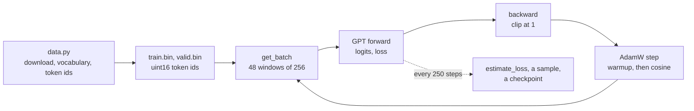

# Pretraining

Pretraining teaches the model to predict the next token of a story. Nothing tells it what a sentence
or a character is: it sees windows of 256 tokens from TinyStories, and at each position it's scored
on how much probability it gave to the token that actually came next. Ten minutes of that on a
laptop takes it from random tokens to short stories that mostly hold together.



## The tokenizer

[`tokenizer.py`](https://github.com/nenuadrian/mvGPT/blob/main/tokenizer.py) splits text into words
and runs of punctuation, with a regular expression, and drops the whitespace:

```text
Once upon a time, a cat said "Hello!"
['Once', 'upon', 'a', 'time', ',', 'a', 'cat', 'said', '"', 'Hello', '!"']
```

The vocabulary is the 10,000 most frequent of these in the training data, after three special tokens:
`[UNK]` for anything outside the vocabulary, `[PAD]` for padding batches, and `<|endoftext|>`, which
separates the stories. TinyStories has about 22,000 distinct tokens in the part we use, but the 10,000
most frequent cover all but about 0.1% of the text. Ties in frequency are broken alphabetically, so
the same data always gives the same ids.

Decoding joins the tokens with spaces and then takes the spaces back out before punctuation. It's a
word-level tokenizer, simpler than the byte-pair encodings of GPT-2 and later models, which split rare
words into pieces and so have no unknown token.

## The data

[`data.py`](https://github.com/nenuadrian/mvGPT/blob/main/data.py) downloads the first 80 MB of
[TinyStories](https://huggingface.co/datasets/roneneldan/TinyStories) and of TinyStories-Instruct
(used for fine-tuning later), builds the vocabulary from both training sets, and writes each split as
a flat array of token ids, `uint16` as the ids are below 65,536. The training set is about 20 million
tokens. Training reads it through `np.memmap`, so it stays on disk.

## The objective

For a window of tokens $x_1, \dots, x_T$, the model gives a distribution over the vocabulary at each
position, and the loss is the average negative log-probability of the token that came next:

$$
\mathcal{L} = -\frac{1}{T} \sum_{t=1}^{T} \log p_\theta(x_{t+1} \mid x_1, \dots, x_t)
$$

That's PyTorch's `F.cross_entropy` on the logits, with the targets being the inputs shifted by one.
The causal mask in attention is what keeps position $t$ from seeing $x_{t+1}$. An untrained model
spreads its probability evenly, so it starts near $\ln(10{,}000) \approx 9.21$.

## The training loop

[`pretrain.py`](https://github.com/nenuadrian/mvGPT/blob/main/pretrain.py) trains for a number of
minutes rather than a number of steps, so it fits whatever machine it runs on:

| Setting | Value | Why |
| --- | --- | --- |
| Batch | 48 windows of 256 tokens | 12,288 tokens a step |
| Optimiser | AdamW, betas (0.9, 0.95) | 0.95 reacts faster to changes in the gradient's scale than 0.999 |
| Weight decay | 0.1, matrices only | biases and LayerNorm gains are left alone |
| Learning rate | warmup to 6e-4 over 100 steps, then cosine to 6e-5 | the cosine follows the time used, ending as the time runs out |
| Gradient clipping | norm 1.0 | a rare bad batch can't throw the weights off |
| Evaluation | every 250 steps | loss on 20 batches of training and validation data, a sample, a checkpoint |

The run logs the loss, the learning rate and the speed every 50 steps, and each evaluation with its
sample, to TensorBoard: see [Watching training](tracking.md).

## What to expect

On an M4 Pro, through PyTorch's MPS backend, it trains at about 27,000 tokens a second, so ten
minutes is about 1,250 steps and 15 million tokens, under one pass over the data. The validation loss
goes from 9.3 to about 2.25, a perplexity of about 9.5, and the most likely next token is the right
one about half the time. A CUDA GPU gets further in the same time, and a CPU less far.

```bash
python data.py
python pretrain.py 10
python sample.py checkpoints/pretrain/model.pt "Once upon a time"
```

## Sampling

[`sample.py`](https://github.com/nenuadrian/mvGPT/blob/main/sample.py) writes stories from a prompt.
At each step it divides the logits by a temperature (below 1 sharpens the distribution, above 1
flattens it), keeps the 50 most likely tokens, and samples from their softmax. It stops at
`<|endoftext|>` or after 200 tokens.

## Evaluation

[`evaluate.py`](https://github.com/nenuadrian/mvGPT/blob/main/evaluate.py) runs checkpoints over the
same 200 windows of validation stories and reports:

- **loss**, the cross-entropy above;
- **perplexity**, $e^{\text{loss}}$: how many tokens the model is choosing between, on average. An
  untrained model is near 10,000;
- **accuracy**, how often the most likely token is the one that came next;
- the five tokens the model finds most likely after "Once upon a time, there was a little".

```bash
python evaluate.py checkpoints/pretrain/step-0.pt checkpoints/pretrain/step-250.pt \
    checkpoints/pretrain/model.pt --out results
```
